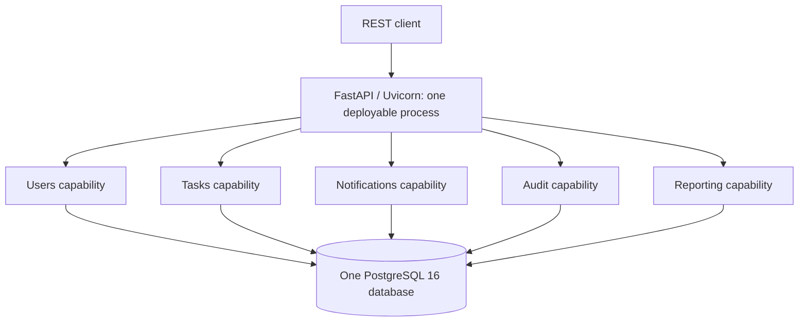
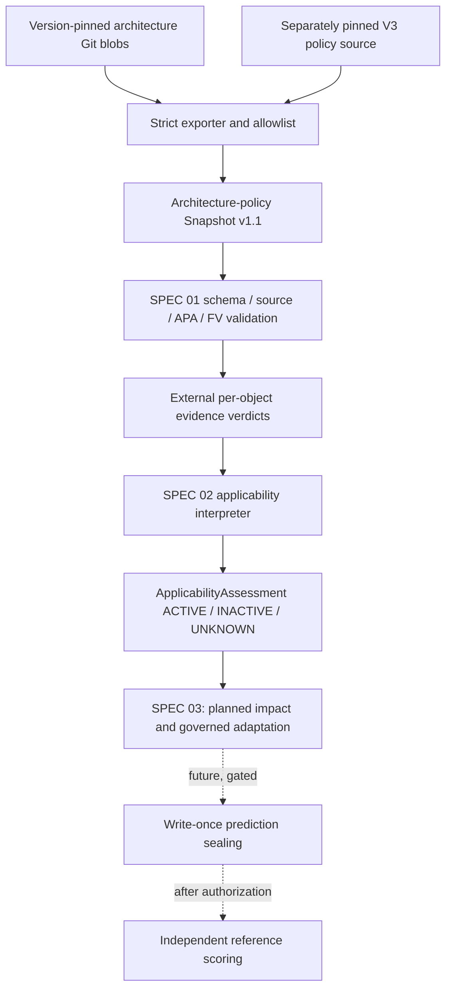

# Implemented architecture and research-tooling boundaries

## Two layers in one repository

**Application layer:** an instrumented, capability-oriented Python monolith (DA01 target `A0_1_CAPABILITY_MODULES`).

**Experiment/method layer:** reproducible architecture/fitness contracts, isolated B0/B1/P inputs, independent scoring/evidence procedures and development-only P preparation. The method code is under `experiments/execution/tooling/`; the benchmark app is under `app/`. Do not import oracle-side logic into the method executor.

### Deployed application topology (current)

The diagram is a **logical** depiction, not separately deployed microservices. Exactly one application process, one database instance, no broker and synchronous Python communication are declared in `architecture/states/A0_1_CAPABILITY_MODULES.yaml`. Docker Compose has one app service and one PostgreSQL service; it does not constitute a distributed service architecture.

### Dependencies and transactions

The preserved allowed cross-capability calls are:
- Tasks service → Users repository, Notifications service and Audit service.
- Users service → Audit service.
- Reporting service → Tasks service.

No enforced public module API, governed cross-module dependency graph, module-owned database boundary or domain event transport has been introduced. `app.db.model_registry` imports capability ORM models into the shared SQLAlchemy `Base`. Task/Notification/Audit effects run within a caller-owned transaction.

Shared infrastructure: `app.api`, `app.db`, `app.config`, `app.experiment`, `app.observability`, `app.models.base`, `app.services.errors`. `app.main` assembles HTTP routers and middleware. Detailed authoritative architecture: `../ARCHITECTURE.md` and `../architecture/states/A0_1_CAPABILITY_MODULES.yaml`.

**Important distinction:** `architecture/acceptance/importlinter.toml` + `tests/architecture/test_module_structure.py` test current engineering acceptance. The frozen `fitness/evaluators/a0/importlinter.toml` is the original A0 research evaluator; do not replace it with a passing current-state checker.

## Research execution path

**Status of individual stages:**
- **Implemented:** versioned snapshot schema, FV_CORE_V1, APA/trust/completeness interfaces, V2 candidate B1/P exporter and strict isolation verification (`p_input_validation.py`, `p_input_export_v2.py`).
- **Implemented for synthetic/development:** canonical AR-DSL and Strong Kleene condition evaluation with policy proofs and trace (`p_applicability.py`); separate, digest-pinned V3 policy source and shared B1/P inputs (`p_policy_source_v3.py`).
- **Existing Phase A infrastructure, not proof of P:** input isolation, B0/B1 preparation, sealing, independent validity/scoring interfaces (`experiments/execution/tooling/`).
- **Not implemented:** end-to-end P Impact Analysis and candidate/operation engine; decision governance, acceptance/rollback; approved production policy authority; completed measured DA01 B0/B1/P studies.

### Repository map

| Path | Responsibility |
| --- | --- |
| `app/` | Benchmark service, business modules, DB, telemetry, experimental fault hooks |
| `architecture/states/` | Declared architecture state; DA01 capability manifest |
| `architecture/acceptance/` | Current engineering dependency acceptance |
| `fitness/catalog/` | Obligation and A0 fitness representation registries |
| `fitness/traceability/` | Baseline links for impact analysis |
| `fitness/evaluators/a0/` | **Frozen experimental evaluator**, not engineering acceptance |
| `experiments/design/` | Controlled evolution trajectory, registered RQs |
| `experiments/scenarios/` | Scenario and independently held ground truth; **never export to method** |
| `experiments/execution/da01/` | Protocol, scoring rules, readiness and isolation |
| `experiments/execution/schemas/` | Contracts for method inputs, candidates, evidence and results |
| `experiments/execution/tooling/` | Research tooling, validator, exporters, applicability, sealer, scorer |
| `experiments/execution/policy-pilot/v1/` | **Draft-only** charter/registry/conditions |
| `experiments/evidence/` | Curated experimental evidence |
| `experiments/results/` | Generated, untracked run outputs |
| `load/` | Locust profiles and warm-up |
| `scripts/` | Seeding, reset, experiment runners, evidence collection |
| `tests/` | Unit, architecture and integration suites |

## Boundary requirements for forthcoming SPEC 03

The P implementation must depend on verified, pinned method inputs and `ApplicabilityAssessment`, not scenario oracle answers. Preserve the separation of **candidate generation** and **independent validation**. Fail closed on invalid inputs; carry UNKNOWN/HOLD through to governance (do not fabricate `retain` or remove obligations to make a scorer happy). Maintain byte-compatible old V1 and SPEC 01 V2 as well as explicitly versioned V3 compatibility. Any new interface gets a contract, provenance, negative tests and requirement-to-test mapping.

