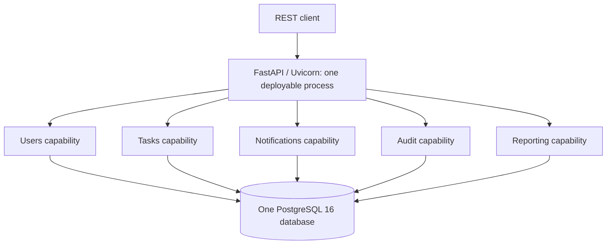
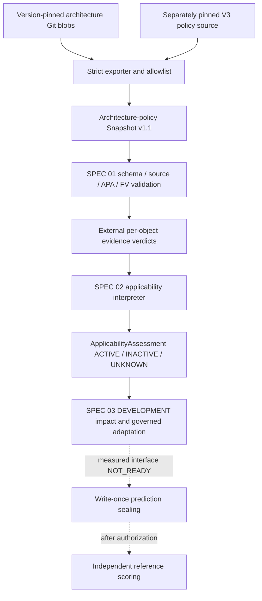

# Implemented architecture and research-tooling boundaries

## Two layers in one repository

**Application layer:** an instrumented, capability-oriented Python monolith. The current engineering state is `A0_3_GOVERNED_MODULE_GRAPH`; this adds mandatory source-based architecture acceptance without changing deployed application topology or behavior.

**Experiment/method layer:** reproducible architecture/fitness contracts, isolated B0/B1/P inputs, independent scoring/evidence procedures and development-only P preparation. The method code is under `experiments/execution/tooling/`; the benchmark app is under `app/`. Do not import oracle-side logic into the method executor.

### Deployed application topology (current)

The diagram is a **logical** depiction, not separately deployed microservices. Exactly one application process, one database instance, no broker and synchronous Python communication remain declared in the preserved A0.1 manifest and the additive A0.3 state record. Docker Compose has one app service and one PostgreSQL service; it does not constitute a distributed service architecture.

### Dependencies and transactions

The A0.3 source policy preserves exactly these capability edges:
- Tasks → Users, Notifications and Audit.
- Users → Audit.
- Reporting → Tasks.

Each capability exposes its W1 public module API. `AC_PUBLIC_API` rejects private cross-capability imports while allowing the exact temporary `Reporting.service → Tasks.service.task_summary` exception in A0.2/A0.3. `AC_MODULE_GRAPH` derives imports from the configured capability source scope and rejects undeclared dependencies, cycles, unresolved local imports, incomplete inspection, or source-identity mismatch. The A0.3 stage gate requires both evaluators to report source-bound `COMPLIANT` results and verifies their manifest, evaluator, configuration, source-file, and raw-diagnostic digests.

The new state is governance-only: it does not migrate the Reporting query port (ΔA4), introduce module-owned databases, change REST behavior, add event transport, or alter transaction ownership. `app.db.model_registry` still imports capability ORM models into the shared SQLAlchemy `Base`. Task/Notification/Audit effects remain within a caller-managed transaction.

Shared infrastructure: `app.api`, `app.db`, `app.config`, `app.experiment`, `app.observability`, `app.models.base`, `app.services.errors`. `app.main` assembles HTTP routers and middleware. Detailed authoritative architecture: `../ARCHITECTURE.md` and `../architecture/states/A0_1_CAPABILITY_MODULES.yaml`.

**Important distinction:** `architecture/acceptance/importlinter.toml` + `tests/architecture/test_module_structure.py` test current engineering acceptance. The frozen `fitness/evaluators/a0/importlinter.toml` is the original A0 research evaluator; do not replace it with a passing current-state checker.

## Research execution path

**Status of individual stages:**
- **Implemented:** versioned snapshot schema, FV_CORE_V1, APA/trust/completeness interfaces, V2 candidate B1/P exporter and strict isolation verification (`p_input_validation.py`, `p_input_export_v2.py`).
- **Implemented for synthetic/development:** canonical AR-DSL and Strong Kleene condition evaluation with policy proofs and trace (`p_applicability.py`); separate, digest-pinned V3 policy source and shared B1/P inputs (`p_policy_source_v3.py`).
- **Implemented for synthetic/development:** generic typed impact analysis, exact-pair validity and coverage, deterministic operation planning, candidate materialization, governance decisions, and conditional rollback checks (`p_impact.py`, `p_semantic.py`, `p_operations.py`, `p_candidate.py`, `p_governance.py`, orchestrated by `p_adaptation.py`). PR #10 records TEST_ONLY no-op and ADD paths reaching ACCEPT.
- **Existing Phase A infrastructure, not proof of P:** input isolation, B0/B1 preparation, sealing, independent validity/scoring interfaces (`experiments/execution/tooling/`).
- **Not established:** production policy/evaluator authority, independent method freeze, production publication, human B1 results, and measured DA01 B0/B1/P outcomes. `p_interface.py` remains `NOT_READY`; TEST_ONLY ACCEPT is software evidence only.

### Repository map

| Path | Responsibility |
| --- | --- |
| `app/` | Benchmark service, business modules, DB, telemetry, experimental fault hooks |
| `architecture/states/` | Preserved A0.1 capability manifest and additive A0.3 governed-graph state record/schema |
| `architecture/acceptance/` | Current engineering dependency acceptance |
| `fitness/catalog/` | Obligation and A0 fitness representation registries |
| `fitness/traceability/` | Baseline links for impact analysis |
| `fitness/evaluators/a0/` | **Frozen experimental evaluator**, not engineering acceptance |
| `experiments/design/` | Controlled evolution trajectory, registered RQs |
| `experiments/scenarios/` | Scenario and independently held ground truth; **never export to method** |
| `experiments/execution/da01/` | Protocol, scoring rules, readiness and isolation |
| `experiments/execution/schemas/` | Contracts for method inputs, candidates, evidence and results |
| `experiments/execution/tooling/` | Research tooling, validator, exporters, applicability, sealer, scorer |
| `scripts/exp01_evidence.py` | A0.1-only DEVELOPMENT evidence collection across engineering acceptance, local Compose observation, and runtime telemetry |
| `experiments/schemas/development_evidence_bundle_v1.schema.json` | Strict DEVELOPMENT evidence bundle schema; execution records are not coverage verdicts |
| `experiments/execution/policy-pilot/v1/` | **Draft-only** charter/registry/conditions |
| `experiments/evidence/` | Curated experimental evidence |
| `experiments/results/` | Generated, untracked run outputs |
| `load/` | Locust profiles and warm-up |
| `scripts/` | Seeding, reset, experiment runners, evidence collection |
| `tests/` | Unit, architecture and integration suites |

## SPEC 03 DEVELOPMENT and review boundaries

The DEVELOPMENT implementation depends on verified, pinned method inputs and `ApplicabilityAssessment`, not scenario oracle answers. Preserve the separation of **candidate generation** and **independent validation**. Fail closed on invalid inputs; carry UNKNOWN/HOLD through to governance (do not fabricate `retain` or remove obligations to make a scorer happy). Maintain byte-compatible old V1 and SPEC 01 V2 as well as explicitly versioned V3 compatibility. Synthetic tests and TEST_ONLY ACCEPT do not establish G1, G4, production authority, or measured readiness. See the [G1 method specification](G1_METHOD_SPECIFICATION.md) and [PR #10 implementation traceability](SPEC_03_IMPLEMENTATION_TRACEABILITY.md).

EXP-01 adds a separate A0.1 DEVELOPMENT evidence runner. It invokes the current engineering Import Linter configuration, samples existing app metrics, and optionally observes the current worktree's Compose containers. Its output is versioned and digest-checked; it never maps evaluator execution to positive `Coverage_P` or `Coverage_ref`. See [the EXP-01 run instructions and evidence limits](../experiments/README.md#exp-01-a01-development-evidence).

