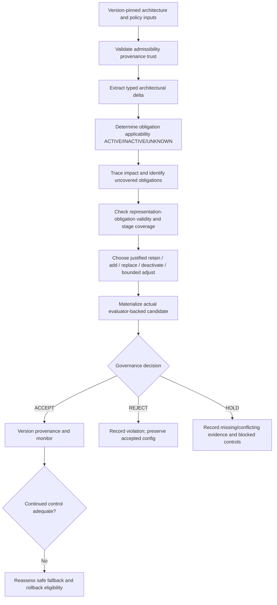

# Research context — why EvoFitBench exists and what method P must prove

> **Audience:** AI coding agents and research collaborators. **Language:** English to match the repository handbook; source manuscript is in Ukrainian.
>
> **Source:** author's working manuscript, *«МОДЕЛЬ І МЕТОД КЕРОВАНОЇ АДАПТАЦІЇ КОНФІГУРАЦІЇ ФУНКЦІЙ ПРИДАТНОСТІ ДЛЯ НАСКРІЗНОГО КОНТРОЛЮ ЕВОЛЮЦІЙНОЇ АРХІТЕКТУРИ ХМАРНИХ ПРОГРАМНИХ СИСТЕМ»*, supplied for this review on 16 October 2026. Section references below identify conceptual origins. **This is an extracted working research rationale, not an approved experiment protocol, authority charter, proof of novelty, or an implementation spec.** The manuscript's implementation-status paragraph is dated 11 October 2026 and predates merged SPEC 01/02.
>
> **Precedence:** for the currently approved experiment follow `experiments/design/ARCHITECTURE_EVOLUTION_SCENARIOS_V1.md`, `experiments/execution/da01/PROTOCOL.md`, `INPUT_ISOLATION.md` and actual schemas/tests. Inconsistencies below are open review items: do not silently edit a frozen protocol or tailor method behavior to an oracle.

## 1. The scientific problem — read this before writing an algorithm

Cloud-native software evolves in structure, component boundaries, interaction mechanisms, deployment topology, and operational conditions. **Architectural fitness functions are mechanisms of control, not the architecture itself.** A function configured for an old architecture may still exit successfully, emit a metric, and look healthy while measuring the *wrong scope, mechanism, or obligation* after an architectural transition. A successful evaluator exit and a present metric therefore do not prove meaningful architectural coverage.

The research problem is **how to keep the *configuration of architectural fitness controls* semantically adequate across architecture changes**. The object being adapted is the *versioned fitness configuration* — its stage-specific representations, metrics, evaluator artifacts, execution policies, scopes and admissible soft parameters — **not automatically the business application or its runtime behavior**. Architecture changes are triggers for evidence-backed reassessment, **not** commands to replace every fitness function.

This distinction is the core of the dissertation contribution: methods for **end-to-end governance of architectural quality criteria throughout CI/test, deployment and runtime**, rather than unrelated checks at each stage.

*Manuscript: Introduction; §1.2–1.3; §2.1–2.4.*

## 2. Goal, proposed contribution and falsifiable claim

**Goal (working):** develop and experimentally evaluate a model and method of *governed adaptation of architectural fitness-function configuration* that preserves meaningful control of relevant architecture properties during cloud-software evolution.

**Proposed methodological contribution:** a general, traceable pipeline that (a) determines policy-backed architectural obligations, (b) identifies potentially affected fitness representations, (c) checks context/semantic/evidence validity, (d) proposes only justified operations, (e) validates a materialized candidate against invariants and cost limits, and (f) versions and monitors accepted decisions with accountable rollback.

**Research hypothesis, not an observed result:** compared with a frozen baseline B0 and independently performed manual/heuristic adaptation B1, this method P may improve impact identification, verified obligation coverage and degradation detection without unacceptable adaptation/monitoring overhead. No such improvement or statistical significance has yet been established by SPEC 01/02 development tests.

**Not claimed:** invention of fitness functions, traceability, adaptive verification or automated monitoring; global/Pareto-optimal architecture or fitness configuration; unconditional absence of errors; generalizability from one DA01 transition. A working implementation alone is engineering evidence, **not** proof of scientific novelty.

*Manuscript: Goal and tasks; §1.3; §3; §5.2.*

### Manuscript-derived research tasks and hypotheses (scientific intent, not an approved protocol)

The manuscript explicitly sets **five tasks**: (1) review evolutionary fitness functions, continuous/adaptive architecture evaluation and unchanged-configuration limitations; (2) formalize the adaptable and invariant components of `Φ`; (3) develop a versioned, validated and rollback-capable governed method; (4) implement an experimental CI/CD and runtime representation prototype; and (5) compare frozen and governed configurations for degradation detection, coverage/consistency and operating cost. These are tasks of **this one dissertation result**, not a claim to solve the entire dissertation.

Its working **H0** is no statistically significant improvement in predefined architectural-control outcomes against unchanged B0 and heuristic B1. Its working **H1** is an empirically supported improvement in at least one predefined detection, coverage or consistency outcome **without unacceptable overhead**. These global hypotheses are **not yet operational null/alternative pairs**: before G1, register primary endpoints, independent units, effect thresholds, treatment of multiple comparisons, acceptable-overhead bounds and analysis procedure. Passing unit tests or observing one favourable DA01 score cannot establish H1.

### Why the research gap is conditional

Evolutionary fitness tests and periodic review already exist (Ford et al.); formal fitness-guided architectural refactoring exists (Chondamrongkul and Sun); continuous development/runtime evaluation exists (Antonino et al.); and model/performance synchronization exists (CIPM/Mazkatli et al.). The **proposed residual gap**, requiring literature review and experimental support, is an explicit, versioned **criterion–obligation–representation–evidence** model plus a general decision procedure to adapt fitness-control *configuration* across architecture changes with accountable activation, semantic coverage, and governed acceptance. Do **not** claim that architecture evaluation, lifecycle feedback, traceability or adaptive verification were invented here. See manuscript §1.1–1.3 and its bibliography for the cited related work.


## 3. Conceptual model: keep these entities separate

| Entity | Meaning | Engineering anchor |
| --- | --- | --- |
| `A_t`, `ΔA_t = Diff(A_t, A_(t+1))` | Before/after architecture state and typed change | Pinned source revisions, strict structural facts |
| `C_i` | Versioned **architectural criterion** with persistent identity, intent, quality attribute, scope and policy | Fitness criterion registry; not the metric or evaluator |
| `q_j` | **Architectural obligation**: concrete normative requirement related to a criterion, with applicability rule, scope, authority and provenance | `fitness/catalog/architectural-obligations.yaml` (18 existing IDs) |
| `R_i^s` / representation `r` | Stage-specific implementation of a criterion (evaluator, metric, normalization, thresholds, execution policy, context, evidence contract) | `fitness/catalog/a0-fitness-elements.yaml`, fitness config, candidates |
| `E_i(t,s)` | Actual evidence with value, source, time, scope, context, version, uncertainty, provenance and completeness | Telemetry/evaluator artifacts; independent validators |
| `Φ_t = <C_t,R_t,α_t,θ_t,H_t,v_t>` | Versioned fitness-control configuration: criteria, representations, optional weights, threshold rules, hard invariants, provenance | Current A0 catalog/config; candidate contract; full P not ready |
| `G_T` | Typed **traceability graph**, linking architectural facts/decisions, obligations, criteria, representations, evaluator artifacts and evidence | `fitness/traceability/a0-traceability.yaml` |
| `Π_t`, `Γ_t` | Normative architecture policies, and **externally verified bounded completeness claims** | APA/Registry/Charter; SPEC 01/02 evidence contracts |
| `Q_t^+, Q_t^0, Q_t^?` | Proven applicable, proven inapplicable and unresolved obligations | SPEC 02 `ApplicabilityAssessment` |

The manuscript formalizes criteria as `C_i = <id, intent, q, scope, policy, version, provenance, links>` and lifecycle representations as `R_i^s = <stage, evaluator, metric, normalization, threshold, executionPolicy, contextSpec, evidenceSchema, artifactLinks>`. A criterion's **intent and critical hard constraints must not be silently weakened** just because a representation/metric changes.

`α_t` and `θ_t` denote *optional* weights and soft thresholds. Dynamic evaluation of an already authorized threshold rule (e.g. `θ_i(t)=g_i(c_t)`) need not be a new configuration version; changing that rule, evaluator, evidence scope or execution policy generally does. Changes to weights/soft thresholds are **future extensions after validating mandatory core adaptation**; do not invent an algorithm for them or claim their benefit from Phase A tests. A high aggregate fitness score must never compensate for a missing mandatory obligation.

*Manuscript: §2.1–2.3; §3.3; §4.1.1.*

## 4. Applicability is not compliance and not coverage

**Applicable** means an approved policy requires an architectural obligation to be controlled in the target architecture. **Compliant** means the actual system satisfies that requirement. **Covered** means a valid representation and sufficient scoped evidence genuinely evaluate that specific requirement. These are different judgments.

A working evidence-based semantics from the manuscript:

```text
K_t = <Z_t, Π_t, Γ_t, ν_t>
g_j(K_t) ∈ {1, 0, ⊥} ≡ {ACTIVE, INACTIVE, UNKNOWN}
g_j = ACTIVE   if every admissible, consistent interpretation supports applicability
g_j = INACTIVE if every such interpretation refutes applicability
g_j = UNKNOWN  otherwise, including unresolved conflict or empty inconsistent model set
```

A missing fact in an incomplete source or missing policy in an OPEN registry **does not imply** its absence. A fact declared in a manifest is not automatically an independently observed runtime truth; a matching SHA proves bytes, not authority or correctness. Negative inferences require verified completeness for the **exact fact type, source revisions and scope**.

`UNKNOWN` is a real state that blocks unsupported deactivation of mandatory obligations. It must not be converted to `FALSE`, `retain` or `deactivate` to satisfy a scorer. Conversely, a method that outputs UNKNOWN for every obligation has not demonstrated successful adaptation; measure decision coverage, false INACTIVE and unresolved evidence.

**Currently implemented:** SPEC 01 validation and SPEC 02 versioned three-state AR-DSL (development/synthetic). **Not supplied:** production-approved Charter/Registry, production trust anchors, independent fact/completeness verification. SPEC 02's draft pilot is not normative authority.

*Manuscript: §2.3 and §2.3.1; §4.1.2–4.1.3.*

## 5. Core method P: intended causal sequence (SPEC 03 and beyond)



**Formal impact starting point:**

```text
ΔZ = Diff(Z_t, Z_(t+1));  ΔΠ = Diff(Π_t, Π_(t+1))
Seed = Map(ΔZ ∪ ΔΠ ∪ ΔQ, G_T)
I_t = Representations(Reach_G(Seed)) ∪ Uncovered(Q_(t+1)^+) ∪ UncertainLinks_t
```

The reachability set contains **possibly affected** representations, not automatically invalid ones. Missing links in an incomplete traceability graph do not prove no impact. Reassess every candidate pair `(r,q)` in the target context:

```text
V(r,q,A_(t+1),E) ∈ {1,0,⊥}
Validity requires:
  ScopeMatch ∧ ContextMatch ∧ EvaluatorAvailable
  ∧ EvidenceSufficient ∧ VersionCompatible
  ∧ PairSpecificSemanticMatch
```

A field `covers: [q]`, a metric name, or evaluator exit code 0 are **insufficient** to prove semantic validity or coverage. Coverage of an obligation requires a validated representation–obligation pair and, if the *authorized* obligation contract requires multiple stages, evidence for each required stage. Do not unilaterally extend frozen DA01 RQ2 scoring: its specific pair-evidence rule remains authoritative until formally reviewed.

**Operation selection rules from the working model:**

- `retain`: representation remains demonstrably semantically valid; no justified replacement.
- `replace`: existing representation is proved unsuitable and a compatible **materialized** evaluator exists.
- `add`: newly/currently applicable mandatory obligation lacks verified coverage and a suitable evaluator artifact exists.
- `deactivate`: only when policy-backed inapplicability is proved **and** the representation supports no other ACTIVE or unresolved mandatory obligations.
- `adjust`: only pre-authorized, bounded soft parameters; never weakens stable intent, hard constraints or mandatory coverage.

If a necessary evaluator artifact cannot be materialized, return `BLOCKED / NEEDS_IMPLEMENTATION`, not a fabricated passing candidate. Candidate preference is *minimum justified change*; the manuscript suggests a predeclared lexicographic preference (number of changes, additional evaluator cost, stable ID) among feasible candidates, **not** global Pareto optimization. A future SPEC must explicitly fix deterministic tie and conflict cases before implementing them.

*Manuscript: §2.4; §3.1–3.3.1; §4.1.1.*

### Why all four scientific mechanisms are needed

| Mechanism | Question it answers | Failure if omitted | Current proof status |
| --- | --- | --- | --- |
| **Obligation Activation** | Which *normative* requirements apply, based on facts, authority and bounded completeness? | An obligation is removed merely because no matching fact or evaluator was observed. | SPEC 02 has a general synthetic/development interpreter; actual authority/evidence is not established. |
| **Architecture Change Impact Analysis** | Which criteria, obligation links, scopes and representations *may* be affected by `ΔA`? | Every check is replaced, or an affected check is incorrectly retained because a trace edge is missing. | Not implemented in P; planned SPEC 03. |
| **Semantic Validity & Evidence Adequacy** | For a particular `(representation, obligation)`, does the evaluator still measure the required property in the correct scope/stage? | A vacuous or stale evaluator reports success while mandatory coverage is lost. | Independent pair-verdict **scoring contract exists**; automatic P pair selection/revalidation is not implemented. |
| **Governed Adaptation** | Is the proposed `Φ'` actually admissible, versioned, justified, and safe to accept or conditionally roll back? | Unverifiable edits, missing mandatory controls, or an unsafe rollback become silently accepted. | Interfaces/protocol exist; P ACCEPT/REJECT/HOLD, materialization, and rollback remain planned. |

**Dependency:** activation determines *what must be controlled*; impact identifies *what must be rechecked*; semantic validity demonstrates *what is genuinely controlled*; governance decides *whether an adaptation is permissible*. Neither a positive applicability decision nor evaluator exit code establishes compliance or coverage. The eventual implementation must include a full SPEC 01–03 verification/validation plan and requirement-to-test matrix (see `docs/TESTING.md`), not just happy-path DA01 fixtures.


## 6. Governance and rollback are substantive, not decorators

```text
Candidate Φ' = T(Φ_t, ΔA_t, Affected_t, operations)
ACCEPT only when verified:
  InvariantOK ∧ MandatoryCoverageOK ∧ SemanticValidityOK
  ∧ EvidenceAdequacyOK ∧ ProvenanceOK ∧ CostOK
REJECT when a mandatory hard condition is proved false.
HOLD when no hard violation is established but essential proof is missing/conflicting.
```

Every decision must explain: architecture/config/rule versions, obligation and representation IDs, operations, reason codes, policy refs, evidence refs, unresolved risks and decision status. Preserve immutable prior configuration and a versioned transition log.

**Rollback is conditional:** an earlier configuration may also be unsuitable for the *new* architecture. Revalidate the rollback target for the current state; if neither candidate nor previous configuration is safely valid, retain an explicitly **unresolved transition** instead of claiming success. Monitoring and rollback are conceptual requirements, **not yet implemented in SPEC 01/02**.

*Manuscript: §3.4–3.4.1.*

## 7. Why these specific experiments?

The experiment changes the **architecture intentionally** while maintaining controlled business behavior, known API, seed, workload and observation contracts. This isolates the effect of the architecture change on the *quality of architectural control*. For DA01, the change is horizontal technical packages → capability modules without new services or network calls. Later designed DA02–DA14 transitions introduce additional governance, service boundaries, remote dependencies, asynchronous delivery and scaling; **those are future design states**, not deployed features.

**B0:** freeze old fitness configuration after architecture change; assess what control it retains and loses.

**B1:** a *real independent human* uses a predefined manual checklist and the same authorized common architecture/policy information. The exact timing/cadence must be settled **before** measured comparisons; see discrepancy register below.

**P:** a general automated, evidence-aware adaptation procedure using the approved common facts/policies and the specifically permitted P-only traceability model; cannot read private oracle, scenario answer lists, independent reference scorer or other methods' outputs.

### Operational scientific questions for the current executable protocol

| RQ | Observable outcomes, not guaranteed improvements |
| --- | --- |
| RQ1 | Precision, recall, F1 of affected-target identification; operation correctness |
| RQ2 | Independently evidenced post-change obligation coverage and semantic validity |
| RQ3 | Detection quality under controlled degradation: precision, recall, F1, FPR/FNR and detection time |
| RQ4 | Adaptation/CI/runtime overhead, memory, CPU, telemetry and active checks |

For **DA01**, execute only the authorized **RQ1/RQ2** procedure when G1/G4 permit it; it cannot demonstrate cloud runtime improvements or statistically significant generalization on its own. Experimental unit is an independently designed architecture transition, not HTTP requests, individual obligations or reruns of the same scenario. The manuscript calls for controlled independent scenarios, descriptive statistics, confidence intervals/effect sizes where appropriate, and *predefined* hypotheses and denominators.

Proposed contrasts with the older static fitness configuration and heuristic B1 are **research hypotheses**, not settled results.

*Manuscript: §5.1–5.8; protocol: `experiments/execution/da01/PROTOCOL.md`.*

### RQ identity crosswalk: manuscript vs executable experiment

**Do not use the two RQ numberings interchangeably.** This table records the discrepancy without redefining either source. `docs/EXPERIMENT.md` and the frozen research design remain authoritative for current executable measurements; the manuscript remains the source of the wider scientific questions.

| Label | Manuscript §5.1 (scientific question, abridged translation) | Existing executable design (operational question) | Reconciliation needed |
| --- | --- | --- | --- |
| **RQ1** | Does governed adaptation improve architectural-control quality versus frozen and periodic heuristic baselines? | Accuracy/F1 of affected-target and operation identification. | Treat impact accuracy as **one outcome** supporting the broader question, not as a full answer. |
| **RQ2** | Does adapting representations, metrics, execution policies, weights and soft thresholds improve coverage and consistency? | Valid post-change obligation coverage and pair-specific semantic evidence. | Weights, soft-threshold adaptation and lifecycle-wide stage obligations are **not yet experimentally evaluated**. |
| **RQ3** | What additional operational costs does governed adaptation introduce? | Controlled-degradation detection quality (F1, FPR, FNR, time). | **Different construct**. Manuscript RQ3 operationally resembles experiment RQ4. |
| **RQ4** | Does formal impact analysis plus validation outperform periodic heuristic review? | Runtime/CI/adaptation overhead. | **Different construct**. Manuscript RQ4 needs a predeclared B1 contrast and possibly ablation; experiment RQ4 is overhead. |

No manuscript RQ has been replaced. A reviewed crosswalk, baseline cadence and formal testable hypotheses are **open decisions** before official measurement (also see M-01/M-02/M-05 in §10).

### Validation design, limits and threats

- **Internal/construct validity:** wrong or vacuous evaluators, stale scope/version evidence, incomplete authority, falsely trusted negative facts, and an incomplete obligation denominator can inflate measured coverage. Require independent exact-pair evidence and separately record UNKNOWN, false INACTIVE, missing evidence, invalid runs and blocked candidates.
- **Comparator validity:** periodic B1 and immediate post-change human B1 are not equivalent interventions; control common facts/policies, actor prior exposure, time budget, human independence, evaluator capability inventory and traceability access. Do not represent synthetic B1 logic as a real operator.
- **Data leakage and confirmation bias:** scenarios/oracles and expected operations must remain outside B1/P inputs and algorithm authoring. Freeze generic P and all scoring choices before independent sealed predictions; keep holdout scenarios separate from development fixtures.
- **Statistical independence:** a controlled architectural delta (not each HTTP request, metric sample, obligation or repeated run) is the unit of architecture-level analysis. DA01 alone permits a case demonstration, not population inference. Repeatability and additional **independently designed** deltas are necessary but not sufficient for external generalization.
- **External/ecological validity:** the controlled Python benchmark, three criteria and initially small FV predicate space may omit cloud production behaviours. Results must state coverage of architectural styles, obligation families, evaluator kinds and trust assumptions; technology-agnostic contracts are not evidence of cross-stack generalizability.
- **Analysis before results:** pre-register numerator/denominator definitions, abstention handling, F1/FPR/FNR, valid mandatory coverage, consistency-violation rate, evaluation/adaptation time and resource/telemetry costs, permissible overhead, uncertainty intervals and effect sizes. Pick statistical tests only after fixing sample design; do not pool correlated repeated observations as independent architecture cases.

**Gates:** the measured DA01 protocol still requires G1 (reviewed/frozen general method and experimental decisions) and G4 (explicit authorization), plus relevant isolation/evidence checks. Synthetic SPEC tests, existing A0 telemetry and successful GitHub Actions are **engineering readiness evidence only**.


## 8. Constraints that every future implementation must preserve

1. **Stable criterion intent:** an evaluator change must not silently change a criterion's semantic meaning.
2. **Mandatory obligations are hard constraints:** cannot be removed because weight drops, global score rises, or telemetry becomes inconvenient.
3. **No inference from absence without bounded completeness:** missing/ambiguous facts, policy conflicts, stale evidence and missing authority propagate UNKNOWN/HOLD appropriately.
4. **No vacuous coverage:** real evaluator artifact, actual relevant target scope, and independent pair-specific semantic/evidence verdict required.
5. **Minimal, deterministic change:** preserve valid controls; do not infer impact from an architectural style string alone.
6. **Separate authority from evidence integrity:** hashes alone do not approve policies or make observations accurate.
7. **Version all decisions and inputs:** architecture revision, policy revision, fact/traceability rules, active configuration, evaluator artifact hashes, decisions and failure reasons.
8. **Keep method and oracle isolated:** exact allowlists; no scenario-specific expected answers, scorer, Git history, cross-method leakage or network access in measured method execution.
9. **Synthetic development ≠ scientific validation:** no fake B1 subjects, measured effects, review gates, approval signatures or results.
10. **Technology-agnostic core:** Python, FastAPI and PostgreSQL are the *bench implementation*, not requirements of the mathematical model.

See `AGENTS.md`, `docs/TESTING.md`, `experiments/execution/da01/INPUT_ISOLATION.md`.

## 9. Concept-to-implementation status (16 October 2026)

| Concept from manuscript | Evidence in repository | Honest status |
| --- | --- | --- |
| Architectural criteria, obligations and base stage representations | `fitness/configs/a0-monolith.yaml`, `fitness/catalog/` | A0 artifacts implemented |
| Versioned architecture/APA/FV Snapshot, validators | `p_input_validation.py`, `p_input_export_v2.py` | SPEC 01 DEVELOPMENT implemented |
| Three-valued obligation applicability, rulebook and V3 pinned policy bundle | `p_applicability.py`, `p_policy_source_v3.py`, pilot policy source | SPEC 02 DEVELOPMENT implemented; pilot DRAFT/OPEN |
| Impact and semantic pair reassessment | `fitness/traceability/a0-traceability.yaml`; interfaces and scoring contracts | **SPEC 03 planned**, not implemented |
| Materialized candidate configuration, deterministic operations | `candidate_configuration.schema.json` and method interfaces | Contracts/preparation only; P selection not implemented |
| ACCEPT/REJECT/HOLD, governed acceptance/monitor/rollback | Manuscript proposed model | **Planned** |
| Actual authorized B0/B1/P measurements and inferential validation | Phase A protocol, sealed scorer, fixtures | **Not authorized / not yet executed** |

`P_ALGORITHM_STATUS = NOT_READY` is a current implementation fact. The manuscript's dated §4.2 status describes an *earlier* working state and must not override the later merged repo commits.

### What can count as a contribution — and what cannot

| Level | Examples in this project | Evidence needed |
| --- | --- | --- |
| **Engineering** | Python parser, JSON Schemas, hashes, GitHub Actions, SPEC 01/02 validators, scenario harness, telemetry instrumentation. | Code review, reproducibility, positive/negative/integration tests; **not a scientific effectiveness claim**. |
| **Methodological** | Explicit obligation states, per-pair semantic/evidence checks, deterministic operation selection, governable explanations, controlled B0/B1/P comparison. | Coherent specification, independent test traceability, falsifying cases and a fair, frozen protocol. |
| **Potential scientific** | A generalizable formally defined method for preserving semantic mandatory architectural control while adapting the *fitness configuration* after `ΔA`. | Prior-work differentiation, soundness/limits of decision rules, comparative independent experimental effects and reported uncertainty. |

Candidate novelty is **conditional**. SPEC 01/02 create prerequisites, not verified benefits. The weighted sum `F = Σ αᵢ fᵢ_norm`, a green CI check, or an implementation-specific framework integration is not itself the new scientific result.


## 10. Open methodological discrepancies — do not silently choose

These items require an explicit independent protocol/monograph reconciliation **before G1 or measured experiments**; documenting them does not authorize changing frozen DA01 files.

| ID | Working monograph says | Existing EvoFitBench contract says | Required action |
| --- | --- | --- | --- |
| M-01 | §5.6 labels B1 **periodic** heuristic review; §5.7.1 explicitly warns that periodic versus post-change reviews are not equivalent | `B1_CHECKLIST.md` runs a documented human review **after** a specific architectural transition | Predeclare cadence, intervention point, time budget and permissible evidence; align manuscript claims or protocol **through review** |
| M-02 | §5.1's RQ3 asks about overhead and RQ4 about benefit of formal impact vs heuristic; earlier §5.7 discusses detection | Executable research design labels **RQ3 = detection**, **RQ4 = overhead** | Freeze one mapping and definitions before statistics; do not report both as though identical |
| M-03 | §4.1.3 calls formal applicability rulebook P-only | Implemented SPEC 02 V3 gives B1/P **identical normative/condition catalog bytes** and P-only traceability | Document an explicit fairness decision: common rules as readable evidence vs P-specific *execution* of the rules; review baseline advantage assumptions |
| M-04 | §3.2.1 includes possible **multi-stage mandatory coverage**, with stages required by obligation | Current DA01 RQ2 contract requires independent pair evidence and a complete obligation denominator, but no general multi-stage requirement registry is frozen | Specify lifecycle-stage requirements/versioning for later scenarios; do not retrofit a new denominator into frozen DA01 scoring |
| M-05 | §2.2 proposes adaptive weights and soft thresholds and §5.1 suggests studying them | Existing P has no weighting/threshold-adjustment algorithm; manuscript §4.1.1 itself defers these to an extension | Do not claim tested weight/threshold effects; scope SPEC 03's minimum viable method and narrow hypotheses |
| M-06 | §5.2 global H0/H1 and inferential ambitions | Current Phase A DA01 is a single architecture delta; G1/G4 not met | Define independent units, baselines, repetitions and statistical plan before claiming significance |

## 11. What an agent should do when starting SPEC 03

- First read `AGENTS.md`, this document, `docs/DOMAIN.md`, `docs/ARCHITECTURE.md`, `docs/EXPERIMENT.md`, `docs/TESTING.md`, SPEC 01/02 implementation journals, and the canonical DA01 protocol.
- Treat formulas here as **research design inputs**, not executable specifications with all ambiguities solved. Produce explicit contracts, edge-case policy and a test matrix before writing P logic.
- Implement general Impact → candidate selection → materialization → governance in independently testable units with typed evidence and explicit UNKNOWN/BLOCKED/HOLD cases.
- Distinguish a P-only decision algorithm from independently verified evaluator execution and scorer access. Preserve B1/P normative-data parity and all frozen inputs.
- Verify with negative, incomplete, conflicting, stale, changed-policy, changed-architecture, no-change, and adversarial multi-obligation cases. Track tests to formal requirements.
- Report remaining research decisions and methodological blockers; **do not invent** missing authority, complete graph, working evaluator, independence of oracle, or experimentally confirmed improvement.

The test framework, CI success and documentation PR are **preparation for** the experiment. A future full P implementation and its synthetic validation must be completed before separately governed measured-run authorization.

