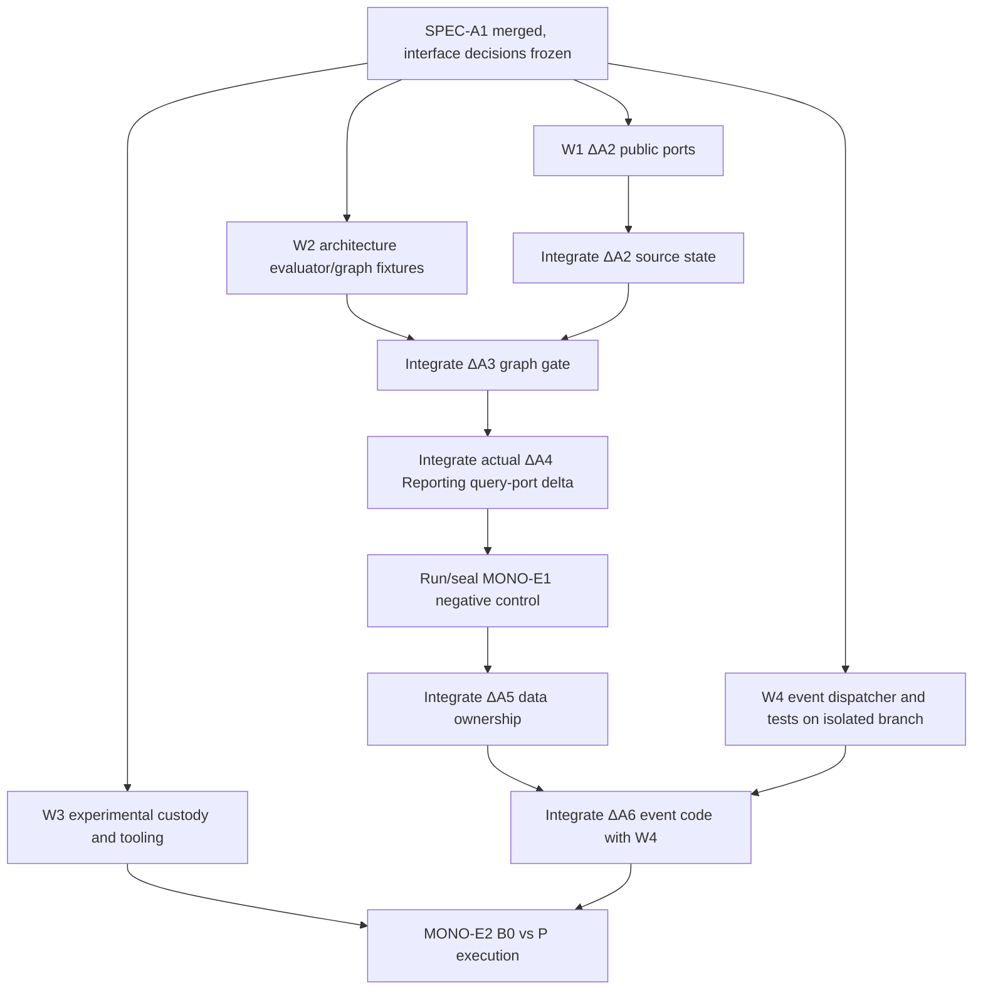

# SPEC-A1-02 v1 — Parallel agents, Git worktrees and merge discipline

**Status:** PROPOSED / orchestration contract. Agents may start contract/audit/test-scaffold work from a reviewed, pinned SPEC branch before merge; merging the specification is preferred before editing shared application source.
**Related:** [architecture contracts](SPEC_A1_ARCHITECTURE_AND_CONTRACTS_V1.md), [experiment contract](SPEC_A1_EXPERIMENT_CONTRACT_V1.md), [critical path](SPEC_A1_CRITICAL_PATH_V1.md).
**Research boundary:** app refactoring is an experimental treatment, not proof of architectural superiority. Do not train/tune Method P on scorer labels or unseen results.

## 1. Fundamental concurrency rule

Separate physical Git worktrees and branches do **not** make simultaneously edited contracts independent. Concurrent agents must use a shared **frozen interface specification** and exclusive write ownership. No agent should merge their own branch, force-push another agent's branch, edit `main`, rewrite frozen source, or silently update an experimental oracle.

The integrator owns architecture-state sequence, source SHA capture, reference custody, integration test runs, conflict resolution, and PR merging. Individual agents own bounded deliverables. Each branch starts at the same recorded integration-base commit until a dependency has merged; dependent implementation rebases/branches from the new integrated HEAD, never a guessed earlier snapshot.

The integration-base commit should normally be SPEC-A1's merge SHA; for earlier non-conflicting preparation, W0 may freeze the current SPEC-branch HEAD as a temporary shared base, then explicitly rebase every dependent worktree after merge. The open PR #25 (evidence-sufficient E1 calibration) is **not** a safe implicit dependency until merged. If its execution utilities are needed, pin its merge SHA separately and re-run compatibility checks. Neither PR #25's E1 nor its status is the monograph MONO-E1.

## 2. Workstream allocation and conflict boundaries

| Agent | Worktree / branch suffix | Exclusive deliverable and initial editable paths | Depends on | Must not edit in parallel |
| --- | --- | --- | --- | --- |
| **W0 Integrator / contracts** | `wt-a1-integrator` / `integrate/a1` | Freeze API/event/graph/ownership interface decisions, integration plan, state manifest skeletons, acceptance and source snapshots; coordinate merged SHA checkpoints | SPEC-A1 approval | Frozen DA01, P/scorer, other agents' application files |
| **W1 Public contracts** | `wt-a1-public` / `feat/a1-public` | ΔA2 `app/modules/*/public.py` public facades/DTO adapters and their focused tests; migrate existing direct cross-module calls **except the documented Reporting legacy edge** | W0 public API contract freeze | `experiments/execution/tooling/*`, scorer/oracle, architecture evaluator owned by W2, final event-dispatch integration owned by W4 |
| **W2 Architecture controls** | `wt-a1-architecture` / `feat/a1-architecture-checks` | Source-derived ΔA2/ΔA3/ΔA5 dependency/ownership evaluators, non-vacuity checks, positive/negative fixtures, test-only sample manifests; ideally under new `architecture/acceptance/a1/` and `tests/architecture/a1/` | W0 graph/ownership contract frozen; reads W1 interfaces read-only | Active `app/modules/*/service.py`, frozen A0 evaluator, DA01 exact tests |
| **W3 Experiment/scorer custody** | `wt-a1-evidence` / `research/a1-evidence` | Versioned monograph experiment contract, RQ crosswalk, scorer-only reference-prep/seal/readback, common denominators, immutable evidence/adversarial tests, archive plumbing | W0 architecture intent, PR #25 merge for any E1 tooling reuse | Application business code; frozen DA01 oracle/scoring; Method P decision logic; agent-produced P predictions before reference freeze |
| **W4 Event protocol** | `wt-a1-events` / `feat/a1-events` | In-process event schema/dispatcher **in new files**, registration/failure-unit tests, rollback integration fixtures prepared against a contract | W0 event contract frozen; application rewiring only after W1/W2/W3 integration as required | `app/modules/tasks/service.py`, `app/modules/notifications/service.py` and `app/modules/audit/service.py` until ΔA5 is integrated |

**Separate integrator-controlled sequential stages:** ΔA4 actual Reporting refactor (must occur on a distinct source revision with reference frozen before P execution); ΔA5 migration of foreign repository access; ΔA6 rewiring Task notification behavior into W4's dispatcher. These stages edit shared business files and **must not** run concurrently with W1's modifications of those files. An agent may prepare a patch in an isolated branch earlier, but its merge and actual test execution depend on final parent SHA.

## 3. Provenance DAG (not five simultaneously mergeable branches)



Do not integrate ΔA5 before the ΔA4 before/after source SHAs and reference are captured. Do not alter baseline B0 for the purpose of making A1 valid. Distinguish code checkpoints from research treatment comparisons.

## 4. Shared integration rules

- W0 alone edits common architecture state manifest registry/index and `docs/ARCHITECTURE.md` during state transitions. W1/W2/W4 may propose documentation patches in their own PRs but must coordinate a single owner before editing shared summaries.
- W1 exclusively edits public interface signatures. W4 must use those interfaces, not guess them. W2 may inspect them but edits only evaluators and fixtures.
- W3 owns `experiments/scenarios/` **new A1 experiment references in restricted custody** and new `experiments/execution/` A1 orchestrator paths. W3 must avoid existing PR #25 files while PR #25 is open; if needed start with an additive schema/protocol and integrate its execution code after PR #25 merge.
- W0 ensures state manifests and runtime evaluator configurations are **per exact Git state**; existing A0.1 frozen manifest and exact DA01 tests remain untouched.
- Creating a new tracked directory outside `docs/` requires a `CONTEXT.md` and ancestor-context updates per `AGENTS.md`; this applies in all five worktrees.
- Do not silently accept a merge conflict that changes an API or expected coverage. Integrator records a revised interface freeze and notifies every dependent agent; merge/rebase the affected branch before executing its acceptance tests.
- A conventional `git merge --no-ff` may preserve architectural stage commits. If squash is used for a stage, pin and verify the resulting **merged state SHA** rather than assuming original branch SHAs remain on `main`.
- Worktree-local virtualenv, UV cache, scratch/evidence directories, Compose project name and disposable DB identifiers must be distinct; use explicit environment variables. Do not run destructive reset against a shared or non-disposable database.

## 5. Example local worktree creation

Run **only after the SPEC-A1 docs are merged** and `origin/main` is verified at the intended base. The code below creates independent branches/worktrees, not active agents automatically.

```bash
git fetch origin
git status --short
BASE_SHA=$(git rev-parse origin/main)   # after SPEC merge\n# Pre-merge preparation alternative, if W0 approves a reviewed/frozen SPEC HEAD:\n# BASE_SHA=$(git rev-parse origin/research/spec-a1-parallel-worktrees-v1)
printf 'Frozen integration base: %s\n' "$BASE_SHA"

git worktree add ../evofit-wt-a1-public       -b feat/a1-public-contracts "$BASE_SHA"
git worktree add ../evofit-wt-a1-architecture -b feat/a1-architecture-evaluators "$BASE_SHA"
git worktree add ../evofit-wt-a1-evidence     -b research/a1-experiment-custody "$BASE_SHA"
git worktree add ../evofit-wt-a1-events       -b feat/a1-event-dispatcher "$BASE_SHA"

git worktree list
```

If branch names or directories exist, stop and inspect; do not reset them. W0 can use the main checkout or its own fifth worktree. In each worktree read `AGENTS.md`, root/local `CONTEXT.md` hierarchy, relevant SPEC-A1 files and real code. Record `git rev-parse HEAD` in each PR.

Example configuration for separate disposable integrations (adapt paths only after inspecting project tooling):

```bash
export UV_PROJECT_ENVIRONMENT="$PWD/.venv"
export UV_CACHE_DIR="$PWD/.uv-cache"
export COMPOSE_PROJECT_NAME="evofit_a1_public"
# Verify the actual disposable PostgreSQL DSN before any migration or reset.
uv sync --frozen --extra dev
```

Each worktree uses its **own** `COMPOSE_PROJECT_NAME` and database resources when integration tests need them; do not run resource-heavy databases simultaneously if the host cannot support it. Avoid shared `experiments/results` run identifiers.

## 6. Handoff and pull request contract

Each agent supplies:

1. Branch name, base/head SHAs and owned-path diff.
2. Requirement IDs addressed (A1-API/GRAPH/NEG/DATA/EVENT or A1-EXP).
3. Inputs/outputs, interfaces assumed and whether frozen interface changed.
4. Tests including a genuine negative control, actual commands and PASS/FAIL/SKIP.
5. New `CONTEXT.md` coverage and changed documentation.
6. Whether source state, research freeze, scorer/oracle, Method P, G1/G4 or runtime authority were touched.
7. Remaining blockers and integration dependencies.

Draft PRs for W1/W2/W3/W4 target `main` or a clearly stated integration branch; never pretend a PR based on missing prerequisite code is ready to merge. Prefer smaller source-scoped PRs over cross-cutting mega-PRs. The integrator merges in DAG order and reruns full `make development-quality` plus current-stage architecture and integration tests on each newly integrated SHA.

## 7. Launch instructions to paste into each coding agent

**All agents:** "Read `AGENTS.md`, `docs/RESEARCH_CONTEXT.md`, `docs/a1/SPEC_A1_ARCHITECTURE_AND_CONTRACTS_V1.md`, `docs/a1/SPEC_A1_PARALLEL_AGENTS_V1.md` and `docs/a1/SPEC_A1_EXPERIMENT_CONTRACT_V1.md`. You own workstream **Wn** only. Operate only in your assigned worktree/branch. Do not merge or edit the frozen research artifacts. First return the exact feasibility issues and planned touched files, then implement your assigned deliverable with adversarial tests and report commit SHA and actual checks. If an unfrozen interface blocks you, prepare independent fixtures/tests but do not make up an interface or conflict with another agent."

**W1 addendum:** "Establish narrow cross-module `public.py` contracts, preserve Task service atomicity, document the temporary Reporting legacy exception, and do not implement ΔA4 in this PR."

**W2 addendum:** "Build non-vacuous source-derived evaluators for AC_PUBLIC_API/AC_MODULE_GRAPH/AC_DATA_OWNERSHIP; prove clean and tampered controlled cases; do not alter application business services."

**W3 addendum:** "Prepare separate A1 author-frozen reference custody and isolation, complete obligation denominator, MONO-E1/2 scorer adapters and evidence checks. Do not read P outputs while setting the reference; do not claim independence of author review or replace frozen DA01 scoring."

**W4 addendum:** "Develop synchronous in-process event dispatcher and rollback tests in isolated new files. Do not edit Task/Notification integration points before ownership and public ports have merged; no broker/outbox/async handlers or autonomous commits."

**W0 addendum:** "Coordinate interface freeze and merge order, implement the actual ΔA4 source-level negative control on a distinct SHA, manage intermediate state IDs, and authorize stage promotion only after tests and verified provenance."
