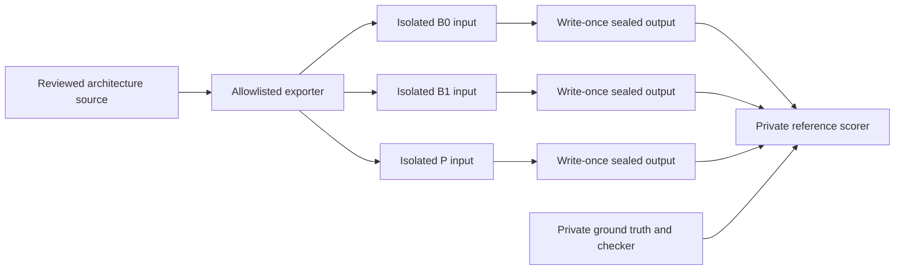
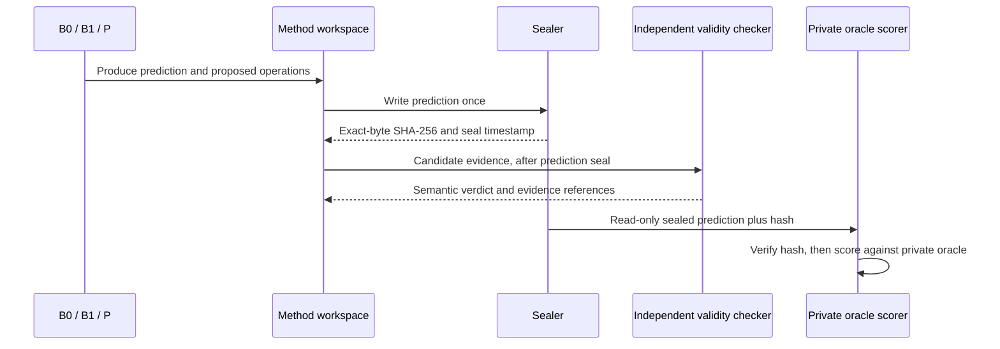
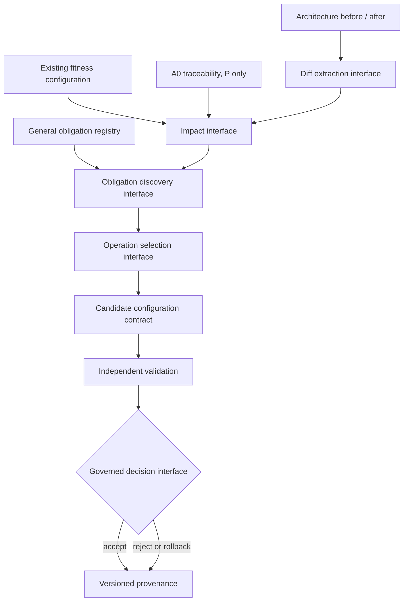

# DA01 execution infrastructure

This package prepares the DA01 Phase A protocol. It provides versioned contracts,
allowlisted method-input bundles, a network-isolated container launcher, write-once
prediction sealing, independent semantic-evidence assessment, and generic RQ1/RQ2
scoring. It does not execute measured DA01 B0/B1/P trials.

## Method boundaries

Each method receives a separate bundle and output directory. The container
launcher mounts only that method's bundle read-only and its output directory
read-write, disables networking, and does not mount the checkout, `.git`, scorer,
ground truth, or another method's output. The scorer accepts sealed prediction
paths as inputs and writes results elsewhere.

## Architecture-to-adaptation interface

The diagram describes interfaces, not an implemented P algorithm. The definition
of `Impact`, general obligation activation, candidate generation, and acceptance
or rollback remains unresolved. P is therefore **NOT READY** for measured use.

## Tooling

Python APIs live in `tooling/`. JSON Schema contracts live in `schemas/`; protocol
decisions and human procedures live in `da01/`. `scripts/da01_execution.py`
offers preparation commands only. The scorer is an oracle-side operation and
must never run in a method container. `score_sealed_prediction` is its entrypoint:
it verifies the immutable seal before loading the private oracle, derives RQ2's
denominator from `required_obligations_after`, and leaves the prediction bytes
unchanged.

Use `make test-unit` for synthetic contract tests. The complete repository gates
remain `make migration-test` and `make quality`; neither runs measured DA01 B0/B1/P
trials. A disposable database is required by the existing migration/quality gate.

Architecture observations derive `app.*` module names relative to their known
export roots. RQ2 requires both a representation execution verdict and a
version 1 obligation verdict for every valid
`(representation_id, obligation_id)` pair; missing or invalid pair evidence
cannot inherit validity from another obligation. Coverage assessments use
schema version 2 and preserve the full private required-obligation denominator.
RQ1 resolves known target IDs from the representation and obligation registries
pinned by the architecture source SHA. Known out-of-universe predictions remain
`FP_extra`; unresolved IDs additionally propagate `PROTOCOL_VIOLATION` into the
sealed scored result.

## Existing result-schema compatibility

`experiments/schemas/result.schema.json` remains unchanged. The new scored-result
contract is an execution envelope; its `legacy_result` projection retains the
existing result fields and operation shapes. The scorer envelope stays schema
version 1; coverage assessments have an explicit version 2 contract and
obligation-level verdicts have a version 1 contract. No legacy result is
generated by Phase A tooling unless a caller supplies sealed synthetic or
measured artifacts.
