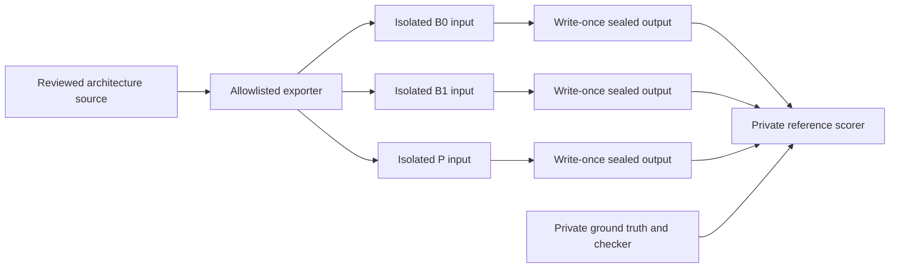
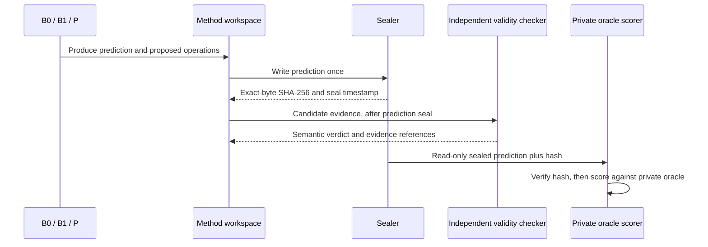
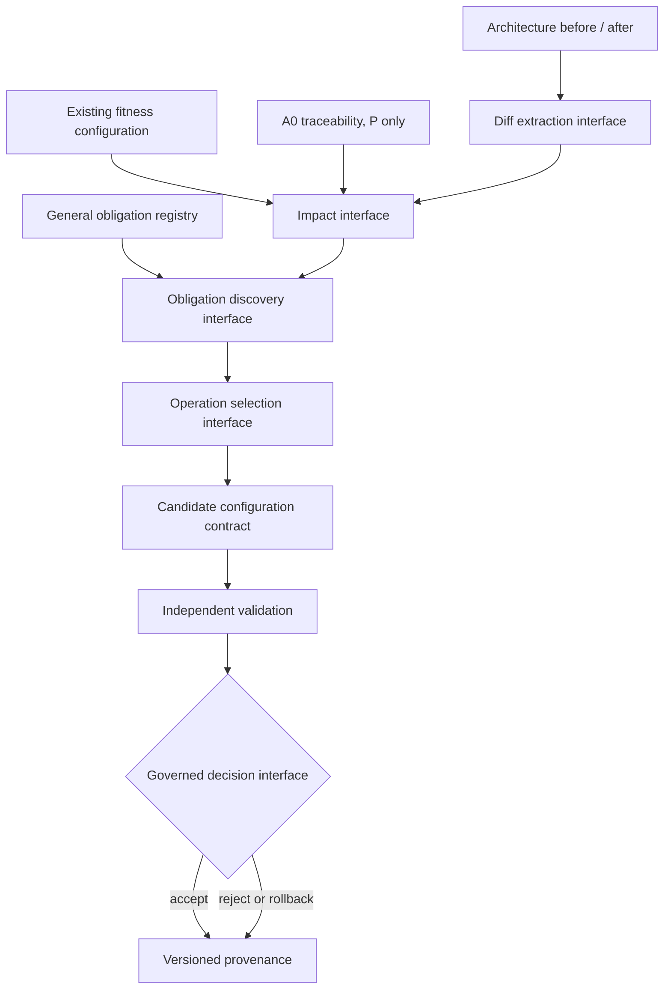

# DA01 execution infrastructure

This package prepares the DA01 Phase A protocol. It provides versioned contracts,
allowlisted method-input bundles, a network-isolated container launcher, write-once
prediction sealing, independent semantic-evidence assessment, and generic RQ1/RQ2
scoring. It does not execute measured DA01 B0/B1/P trials.

## MONO-A1 monograph evaluation preparation

`MONO_A1_PROTOCOL_V1.md` defines the separate MONO-E0/E1/E2 namespace, RQ
crosswalk, freeze-before-run custody process, common RQ2 denominator, and
source/evaluator evidence requirements. W0 has fixed MONO-E2 to `A0_MONOLITH` at `b78b0967be937634b7762baccf5ac6892b279a73` → final `A1_MODULAR_MONOLITH`; the after SHA remains unassigned until verification. MONO-E1 Method P execution remains blocked by the `G-A1-C4-REF-FROZEN` checkpoint and [W0 reference-freeze checklist](MONO_A1_REFERENCE_FREEZE_CHECKLIST.md). The additive contracts are
`schemas/mono_a1_study_v1.schema.json`,
`schemas/mono_a1_reference_v1.schema.json`, and
`schemas/mono_a1_exact_pair_evidence_v1.schema.json`; the synthetic custody and
scoring helpers are in `tooling/mono_a1.py`.

These contracts do not alter DA01 or the DEV-B0P-E1 calibration. They do not
execute MONO-E1/E2. W2 Draft PR #28 defines the report interface consumed by
`W2A1ExactPairReadbackVerifier`; use the evaluator's exact pinned checkout for
readback. Missing or mismatched evaluator bytes keep exact-pair results
UNKNOWN. W0 must still verify final A1, freeze exact source revisions, and pass the E1 ΔA4 checkpoint. The
Ukrainian reporting template is
[`MONO_A1_RESULTS_TEMPLATE_UK.md`](MONO_A1_RESULTS_TEMPLATE_UK.md).

## Method boundaries

Each method receives a separate bundle and output directory. The container
launcher mounts only that method's bundle read-only and its output directory
read-write, disables networking, and does not mount the checkout, `.git`, scorer,
ground truth, or another method's output. The scorer accepts sealed prediction
paths as inputs and writes results elsewhere.

## Architecture-to-adaptation interface

The generic development pipeline now implements these boundaries in
`tooling/p_impact.py`, `p_semantic.py`, `p_operations.py`, `p_candidate.py`,
`p_governance.py`, and `p_adaptation.py`. It reuses SPEC 02 applicability and
uses additive DEVELOPMENT contracts. This implementation does not resolve the
open scientific decisions in SPEC 03 and is **NOT READY** for measured use;
see [`P_GOVERNED_ADAPTATION_V1.md`](P_GOVERNED_ADAPTATION_V1.md) and
[`da01/P_ALGORITHM_STATUS.md`](da01/P_ALGORITHM_STATUS.md).

## Tooling

Python APIs live in `tooling/`. JSON Schema contracts live in `schemas/`; protocol
decisions and human procedures live in `da01/`. `scripts/da01_execution.py`
offers preparation commands only. The scorer is an oracle-side operation and
must never run in a method container. `score_sealed_prediction` is its entrypoint:
it verifies the immutable seal before loading the private oracle, derives RQ2's
denominator from `required_obligations_after`, and leaves the prediction bytes
unchanged.

Use `make test-unit` for synthetic contract tests. The complete repository gates
remain `make migration-test` and `make quality`; neither runs measured DA01 B0/B1/P
trials. A disposable database is required by the existing migration/quality gate.

Architecture observations derive `app.*` module names relative to their known
export roots. RQ2 requires both a representation execution verdict and a
version 1 obligation verdict for every valid
`(representation_id, obligation_id)` pair; missing or invalid pair evidence
cannot inherit validity from another obligation. Coverage assessments use
schema version 2 and preserve the full private required-obligation denominator.
RQ1 resolves known target IDs from the representation and obligation registries
pinned by the architecture source SHA. Known out-of-universe predictions remain
`FP_extra`; unresolved IDs additionally propagate `PROTOCOL_VIOLATION` into the
sealed scored result.

## Existing result-schema compatibility

`experiments/schemas/result.schema.json` remains unchanged. The new scored-result
contract is an execution envelope; its `legacy_result` projection retains the
existing result fields and operation shapes. The scorer envelope stays schema
version 1; coverage assessments have an explicit version 2 contract and
obligation-level verdicts have a version 1 contract. No legacy result is
generated by Phase A tooling unless a caller supplies sealed synthetic or
measured artifacts.
