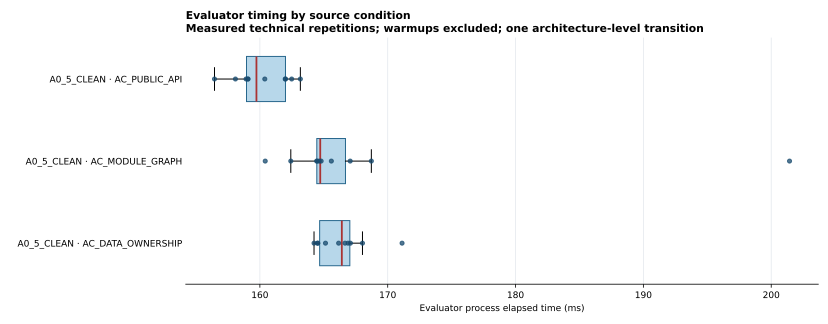

# Власницьки авторизоване DEVELOPMENT-дослідження ΔA5 — фактичний звіт запуску 40499692594

- **Study ID:** MONO_CI_B0_PSI_DELTA_A5_OWNER_AUTHORIZED_DEV_V1.
- **Класифікація:** RESEARCH_OWNER_AUTHORIZED_EXPLORATORY_DEVELOPMENT.
- **Авторизація:** пряма інструкція користувача від 2026-10-27; вона дозволяє виконання в межах цієї розмови. Незалежної перевірки особи, підпису чи зовнішнього схвалення немає.
- **Архітектурна одиниця:** одна запланована пара A0.4→A0.5; технічні повтори не є незалежними архітектурними спостереженнями.
- **CI:** [run 40499692594](https://github.com/Pan14ek/evofit-bench/actions/runs/40499692594).
- **Первинний архів:** [GitHub release asset](https://github.com/Pan14ek/evofit-bench/releases/tag/mono-ci-psi-a05-owner-authorized-40499692594-1); він не містить пізнішого post-run readback.
- **Post-run readback:** окремо зафіксований у цьому PR в `evidence/40499692594/POST_RUN_PROBE_READBACK.json` і `analysis/negative-probe-post-run-readback.csv`.

## Фактичний підсумок

На чистому джерелі A0.5 три статичні оцінювачі дали по десять вимірюваних результатів COMPLIANT без finding codes. Їхній inspection scope пройшов для всіх трьох оцінювачів.

На історичній негативній пробі PR #56 усі 33 evaluator-процеси (по одному прогріву й десять повторів для кожного оцінювача) створили сирі JSON-виходи зі статусом COMPLETED. Під час первинного запуску окремий scope verifier помилково шукав commit проби в Git-базі чистого A0.5 checkout. Тому 33 первинні measurement records позначено FAILED. Після запуску ті самі збережені виходи повторно перевірено тим самим замороженим scope verifier на точному replay checkout проби: 33/33 перевірки пройшли. Сирі результати: AC_DATA_OWNERSHIP повідомив FOREIGN_TABLE_ACCESS у 11/11 виходах; AC_MODULE_GRAPH і AC_PUBLIC_API були COMPLIANT без findings у 11/11 кожен. До цих 11 входять прогрів і десять запланованих повторів. Це відома історична проба, не новий holdout і не вхід Ψ.

Порівняння B0/Ψ не дало придатного до звіту результату. В усіх чотирьох спробах запуск ізольованого методу зупинився під час створення мережевого namespace: bwrap: loopback: Failed RTM_NEWADDR: Operation not permitted. Рішення Ψ, план операцій, кандидат і його оцінка не спостерігалися. Це не HOLD.

У transition runner B0 evaluator matrix збирається перед запуском Ψ. Після помилки чотири часткові директорії не потрапили до завантаженого bundle. Тому сирі B0-виходи з цих переходів не збережені й не звітуються як перевірені. CSV переходів має лише заголовок. Це дефект збереження часткових артефактів.

## Заморожені умови

Перед запуском було зафіксовано commit 1bc90aab8f1973a274381685dbd5309f95dd1837. SHA-256 запису фіксації — ff1a995b85f891b57530c2b9dde2391250c4378298ea4394d79176b6d6c97ec5; SHA-256 протоколу — 6c0a05b55fd1cf963b7141ec0edb4abbebd25b046664c13cb149dbffe8398eca.

- A0.4: d3101c0d3aa9b7b709253b6ec7518416f05f65b9.
- A0.5: a349d19fb89b577e6799e9736ed4ce0acc572166.
- Дерево застосунку обох версій: 007196f68652bc13f6798805793ffdfae96f95f7.
- B0-конфігурація: AC_PUBLIC_API та AC_MODULE_GRAPH; SHA-256 реконструкції 9a8c15fabc41ec6e079b3ec708a60dcc0320fa5e7370e1416123e9ec4f64643d; статус NOT_APPROVED.
- План: 66 калібрувальних викликів, один прогрів і десять вимірювань на комірку; один прогрів і три технічні спроби переходу. Ліміт — 2700 с загалом, 900 с на калібрування і 1800 с на перехід. Це авторські операційні припущення, не незалежно затверджена модель вартості.

Історичну пробу PR #56 успішно відтворено за закріпленими байтами. Post-run перевірка використовувала точний probe commit 5ace86095bda794c9576047c80b9267e70cd0f26 і те саме заморожене правило inspection scope на відповідному probe checkout. Це технічний readback, не новий запуск, не незалежна семантична оцінка та не новий holdout.

## Калібрування чистого A0.5

Час процесу CLI наведено в мілісекундах. Статистика охоплює десять успішних вимірюваних повторів на комірку; прогрів виключено. p90 — nearest-rank. Scope наведено окремо.

| Оцінювач | n | Результат у 10/10 | Перевірено елементів | Середнє | Медіана | SD | Мін–макс | p90 | Scope, середнє |
|---|---:|---|---:|---:|---:|---:|---:|---:|---:|
| AC_DATA_OWNERSHIP | 10 | COMPLIANT, без findings | 32 | 166.436 | 166.411 | 2.086 | 164.236–171.123 | 168.026 | 251.130 |
| AC_MODULE_GRAPH | 10 | COMPLIANT, без findings | 31 | 168.403 | 164.723 | 11.824 | 160.419–201.432 | 168.720 | 324.961 |
| AC_PUBLIC_API | 10 | COMPLIANT, без findings | 31 | 160.162 | 159.732 | 2.192 | 156.451–163.167 | 162.488 | 242.000 |

Для кожного успішного виклику інспекція була COMPLETE; missing, altered та unexpected counts дорівнювали нулю. Це технічний результат на конкретному джерелі, а не доказ семантичної правильності, повноти нормативного denominator або Representation Coverage.

## Історична негативна проба: сирі виходи та post-run readback

Під час первинного калібрування всі 33 рядки цієї умови отримали sample_status FAILED, бо scope verifier не знайшов probe commit у clean subject Git database. Водночас кожен evaluator завершився, а його evaluator-output.json збігався з stdout.bin за SHA-256. Проблема сталася після evaluator execution: caller передав verifier-у clean checkout замість probe checkout.

Після запуску точний probe було повторно відтворено; тим самим verifier-ом перевірено всі 33 збережені JSON-виходи на правильному Git checkout. Усі 33 мали source inspection COMPLETE і нуль missing, altered або unexpected файлів. Первинні execution records і їхні статуси не змінювалися. Для цих рядків process duration у первинному record відсутній, тому вони не входять до часової статистики.

| Оцінювач | Raw outputs; 1 прогрів + 10 повторів | Сирий evaluator result | Post-run scope | Межа висновку |
|---|---:|---|---|---|
| AC_DATA_OWNERSHIP | 11/11 | NON_COMPLIANT; FOREIGN_TABLE_ACCESS | COMPLETE, 11/11 | Виявлення саме цього відомого probe |
| AC_MODULE_GRAPH | 11/11 | COMPLIANT; без findings | COMPLETE, 11/11 | Не оцінює цю зміну в межах його статичного правила |
| AC_PUBLIC_API | 11/11 | COMPLIANT; без findings | COMPLETE, 11/11 | Не оцінює цю зміну в межах його статичного правила |

Цей результат є описом трьох реалізацій на одній відомій, раніше спостереженій пробі. Він не встановлює загальну чутливість/специфічність, незалежну точність або результат на holdout.

Калібрувальний архів і analysis-summary збережені без змін: вони точно відображають первинні FAILED статуси. Додатковий record POST_RUN_PROBE_READBACK.json фіксує окреме технічне readback, а negative-probe-post-run-readback.csv містить 33 виходи з їхніми digest-ами й перевірками scope.

## B0 і Ψ: спроби, а не порівняння

| Роль | Кількість | Статус | Спостережене |
|---|---:|---|---|
| Прогрів | 1 | FAILED | Помилка створення мережевого namespace bubblewrap |
| Вимірювані повтори | 3 | FAILED | Та сама помилка до результату Ψ |
| Рядки даних у transition-samples.csv | 0 | NOT_OBSERVED | B0 та Ψ outcomes відсутні в перевіреному bundle |

Тривалість невдалих запусків становила 3,877.026; 3,934.486; 3,952.292; і 3,939.107 мс. Це час до помилки ізоляції, не час Ψ і не метрика B0. Сукупно процеси використали 12.132740 CPU-с user і 3.717022 CPU-с system. Грошові витрати GitHub Actions окремо не виміряні.

Мережеву ізоляцію не послаблювали й метод поза нею не запускали. Наступний технічний крок — підтримуваний ізоляційний runner, який може створити заборонений для мережі namespace, плюс збереження часткових evaluator-виходів до запуску методу. Для зміни runner або retention потрібен новий версійований протокол і freeze до нових результатів.

## Перевірка архіву

Маніфест калібрувального архіву перелічує 279 data members (плюс сам manifest entry); розміри та SHA-256 усіх перелічених членів звірено, невідповідностей немає. SHA-256 архіву — d4851c292497728b98af5a75aa8f01883541eb5672274896cf6065cd0c612d27. SHA-256 measurement-records.jsonl — 94870fce4a47230e8eef4886040a05c9bb17ee1776c7d7dfba2c592176005be5.

SHA-256 фінального GitHub release asset — 655d92a407cd738af6a250f115725d7a8f733b29ece95b7316bcde4ded9df41d; локальна копія має той самий digest. Перевірка release analysis звітує verification_status PASS. Post-run probe readback зафіксовано окремо з record SHA-256 26f81d389a0af61ccaa15e34b803dbe380320e5b0a2ae6bab278fd0a964be2a0.

Файли для відтворення:
- study-execution.json — початкові підсумки та статуси калібрування, source identities і переходів.
- evidence/40499692594/calibration.zip — raw evaluator JSON, stdout/stderr, records і manifest.
- evidence/40499692594/POST_RUN_PROBE_READBACK.json та analysis/negative-probe-post-run-readback.csv — додаткова перевірка тих самих збережених виходів.
- analysis/evaluator-samples.csv та analysis/transition-samples.csv — початкові таблиці; перша відображає первинні FAILED записи, друга не має рядків даних.
- analysis/analysis-summary.json та analysis/evaluator-time-distributions.svg — первинна описова статистика й графік чистого A0.5.
- evidence/40499692594/OWNER_AUTHORIZED_RELEASE.zip — точна копія первинного durable release archive з raw даними; post-run readback зберігається окремими файлами вище.

## Межі наукового висновку

Дані описують час і виходи трьох evaluator-ів на одному чистому джерелі A0.5 та raw-реакцію на одну відому історичну пробу після технічного post-run readback. Вони не містять порівняння B0 проти Ψ і не вимірюють ефект адаптації. Тридцять чистих повторів — технічні повтори на одній архітектурній одиниці, а не 30 незалежних випадків. Статистичні тести й coverage не обчислювалися.

Стан: P_ALGORITHM_STATUS=NOT_READY; G1=INCOMPLETE; G4=NOT_AUTHORIZED; independent reference=NOT_READY; scoring=NOT_EXECUTED; coverage=UNKNOWN; official ΔA5=NO_GO. Власницька авторизація не є незалежною валідацією чи нормативним схваленням.

### Текст для монографії

У дослідницьки авторизованому CI-калібруванні на одному чистому джерелі A0.5 три статичні оцінювачі виконали по десять вимірюваних повторів із COMPLETE inspection scope і без finding codes; середній час CLI становив 160.162–168.403 мс. На відтвореній історичній пробі, після post-run перевірки тих самих збережених evaluator-виходів на точному probe checkout, AC_DATA_OWNERSHIP повідомив FOREIGN_TABLE_ACCESS у десяти вимірюваних повторах, тоді як AC_MODULE_GRAPH та AC_PUBLIC_API повідомили COMPLIANT без findings. Первинні записи цих повторів позначені FAILED через помилку in-run scope readback і не містять process duration; post-run readback не змінював сирі записи. Чотири спроби ізольованого переходу B0/Ψ не надали рішення методу: bubblewrap не створив мережевий namespace. Отже, запуск дає технічні калібрувальні спостереження з обмеженнями відтвореної probe, але не порівняння B0 і Ψ. Незалежна валідація відсутня; G1 залишається INCOMPLETE, G4 — NOT_AUTHORIZED.

_Генерований runner-ом звіт усередині релізного архіву збережено без змін. Цей фактичний звіт уточнює його planned-run формулювання відповідно до машинного execution record: completed_runs=0, failed_runs=4, transition CSV без рядків даних._
