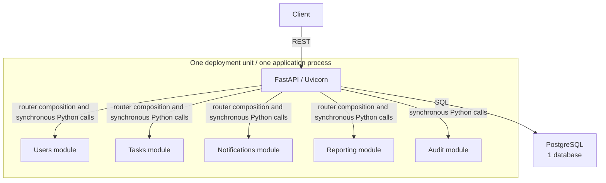
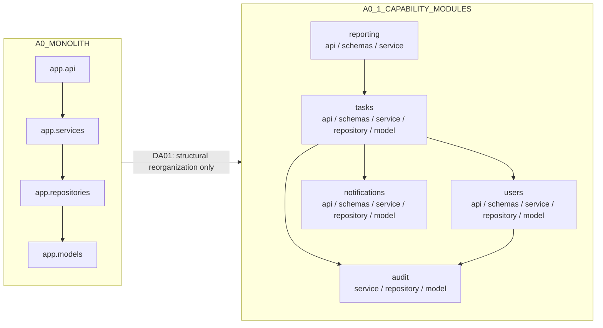
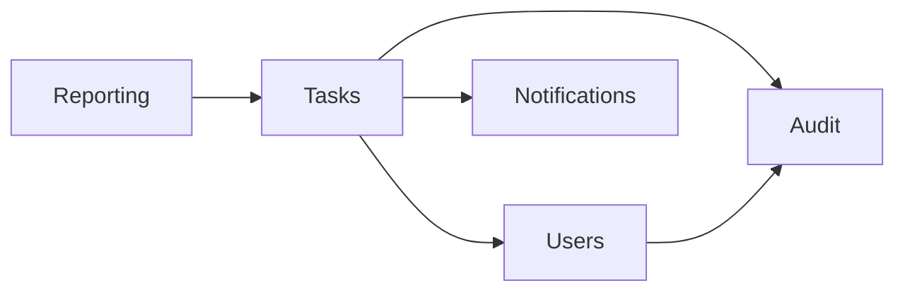

# DA01: Controlled architecture delta

## 1. Scenario identity

| Field | Value |
| --- | --- |
| Scenario | `DA01` |
| Delta | `ΔA1` |
| Source architecture | `A0_MONOLITH` |
| Target architecture | `A0_1_CAPABILITY_MODULES` |
| Frozen source tag | `arch-a0-monolith-v1` |
| Frozen source revision | `b78b0967be937634b7762baccf5ac6892b279a73` |
| Research-schema starting revision | `ccf10da8de2ac99e6cca0c6ed20e6be1d5e25032` |
| Scenario definition | [`scenario.yaml`](scenario.yaml) |
| Frozen ground truth | [`ground_truth.yaml`](ground_truth.yaml) |

The ground truth was frozen before implementation. DA01 expects `REP_A0_ARCH_CI_LAYERING` to be replaced and `AC_MODULE_STRUCTURE` to be added. Performance and reliability criteria remain unaffected. No method-specific result records are part of this implementation.

## 2. Research purpose

DA01 tests whether an architecture change causes fitness governance to identify one existing representation that needs replacement and one new architectural obligation that needs addition, while retaining unrelated performance and reliability representations. It does not test whether capability organization improves performance or reliability.

The intended relationship is:

```text
architecture change -> affected fitness configuration
```

Performance, reliability, and workload measurements remain separate from the structural treatment.

## 3. Source architecture

The source is the A0 horizontal package structure:

```text
app.api -> app.services -> app.repositories -> app.models
```

It runs as one FastAPI/Uvicorn process against one PostgreSQL database. Modules communicate through synchronous Python calls. Task assignment and status changes commit task, audit, and notification writes through one SQLAlchemy session transaction.

## 4. Target architecture

The target organizes business code into five capability packages:

| Capability | Package | Files |
| --- | --- | --- |
| Users | `app.modules.users` | `api.py`, `schemas.py`, `service.py`, `repository.py`, `model.py` |
| Tasks | `app.modules.tasks` | `api.py`, `schemas.py`, `service.py`, `repository.py`, `model.py` |
| Notifications | `app.modules.notifications` | `api.py`, `schemas.py`, `service.py`, `repository.py`, `model.py` |
| Reporting | `app.modules.reporting` | `api.py`, `schemas.py`, `service.py` |
| Audit | `app.modules.audit` | `service.py`, `repository.py`, `model.py` |

The exact machine-readable contract is [`architecture/states/A0_1_CAPABILITY_MODULES.yaml`](../../../architecture/states/A0_1_CAPABILITY_MODULES.yaml). The runtime still has one deployment unit, one FastAPI/Uvicorn process, one PostgreSQL database, synchronous Python calls, and no broker.



## 5. Controlled treatment

DA01 changes horizontal technical package organization to capability-oriented package organization. Application behavior and system topology remain fixed.



## 6. Preserved invariants

- The public REST paths, methods, request and response semantics, validation behavior, and status codes are unchanged.
- The same PostgreSQL tables, columns, SQL types, constraints, foreign keys, indexes, enum values, and shared SQLAlchemy `Base` remain in use. Alembic head remains `0001_a0_schema`; no migration was added.
- Task assignment and status updates keep task, notification, and audit changes in one transaction. Notification failure still rolls back all three and leaves the notification counter unchanged.
- The deterministic seed remains 100 users, 500 tasks, zero notifications, and zero audit events. The expected fingerprint is `074aba9f614f5cc348729261dbc4ce2588ae5d270a2f8adb54cc01df0dfe89d9`.
- The checked-in smoke, baseline, and warm-up workload files are byte-identical to the A0 files.
- Metric names, types, help text, and label names are unchanged. Fault controls `task_delay_ms`, `notification_delay_ms`, and `fail_next_n_notifications` retain their A0 semantics.
- Runtime topology remains one deployment unit, one application process, one PostgreSQL database, synchronous Python communication, and no broker.

## 7. File migration map

| A0 path | DA01 path |
| --- | --- |
| `app/api/users.py` | `app/modules/users/api.py` |
| `app/schemas/users.py` | `app/modules/users/schemas.py` |
| `app/services/user_service.py` | `app/modules/users/service.py` |
| `app/repositories/user_repository.py` | `app/modules/users/repository.py` |
| `app/models/user.py` | `app/modules/users/model.py` |
| `app/api/tasks.py` | `app/modules/tasks/api.py` |
| `app/schemas/tasks.py` | `app/modules/tasks/schemas.py` |
| `app/services/task_service.py` | `app/modules/tasks/service.py` |
| `app/repositories/task_repository.py` | `app/modules/tasks/repository.py` |
| `app/models/task.py` | `app/modules/tasks/model.py` |
| `app/api/notifications.py` | `app/modules/notifications/api.py` |
| `app/schemas/notifications.py` | `app/modules/notifications/schemas.py` |
| `app/services/notification_service.py` | `app/modules/notifications/service.py` |
| `app/repositories/notification_repository.py` | `app/modules/notifications/repository.py` |
| `app/models/notification.py` | `app/modules/notifications/model.py` |
| `app/api/reports.py` | `app/modules/reporting/api.py` |
| `app/schemas/reports.py` | `app/modules/reporting/schemas.py` |
| `app/services/report_service.py` | `app/modules/reporting/service.py` |
| `app/services/audit_service.py` | `app/modules/audit/service.py` |
| `app/repositories/audit_repository.py` | `app/modules/audit/repository.py` |
| `app/models/audit_event.py` | `app/modules/audit/model.py` |

Shared files remain at their A0 locations. `app.db.model_registry` imports the four capability models so Alembic and the application register them on the same `app.models.base.Base`. The old business files and the empty `app.repositories` and `app.schemas` packages were removed; no compatibility re-exports remain.

## 8. Module manifest

| Package | Required files |
| --- | --- |
| `app.modules.users` | `__init__.py`, `api.py`, `schemas.py`, `service.py`, `repository.py`, `model.py` |
| `app.modules.tasks` | `__init__.py`, `api.py`, `schemas.py`, `service.py`, `repository.py`, `model.py` |
| `app.modules.notifications` | `__init__.py`, `api.py`, `schemas.py`, `service.py`, `repository.py`, `model.py` |
| `app.modules.reporting` | `__init__.py`, `api.py`, `schemas.py`, `service.py` |
| `app.modules.audit` | `__init__.py`, `service.py`, `repository.py`, `model.py` |

`tests/architecture/test_module_structure.py` compares the checked-in manifest to the exact expected module, file, shared-infrastructure, dependency, and governance contract. It does not enforce cross-module APIs or dependency directions.

## 9. Intentionally preserved cross-module dependencies

These direct synchronous dependencies remain from A0 and are intentionally permitted:

| Caller | Callee |
| --- | --- |
| `app.modules.tasks.service` | `app.modules.users.repository` |
| `app.modules.tasks.service` | `app.modules.notifications.service` |
| `app.modules.tasks.service` | `app.modules.audit.service` |
| `app.modules.users.service` | `app.modules.audit.service` |
| `app.modules.reporting.service` | `app.modules.tasks.service` |



No public module APIs, module dependency graph rules, data-ownership enforcement, or event communication were introduced.

## 10. Engineering acceptance and experimental evaluator

The A0 experimental evaluator is frozen at `fitness/evaluators/a0/importlinter.toml` and remains associated with `REP_A0_ARCH_CI_LAYERING`, `A0_MONOLITH`, tag `arch-a0-monolith-v1`, and source revision `b78b0967be937634b7762baccf5ac6892b279a73`. It preserves the original global A0 contracts and was not rewritten after migration.

Current engineering acceptance uses `architecture/acceptance/importlinter.toml` for module-local layering and `tests/architecture/test_module_structure.py` for `AC_MODULE_STRUCTURE`. Run it with `make architecture-test`. Engineering acceptance is a repository guardrail, not a B0/B1/P result.

The frozen evaluator invocation was verified before migration:

```bash
uv run lint-imports --config fitness/evaluators/a0/importlinter.toml
```

## 11. Validation procedure

1. Confirm the starting revision, A0 tag, and frozen DA01 ground truth.
2. Run the existing quality suite against a disposable PostgreSQL database before moving code.
3. Reset that disposable database, capture `a0-*` contracts, and record exact-byte workload hashes.
4. Move the business files and update only package imports, router composition, model registration, and architecture acceptance.
5. Reset the disposable database, capture `da01-*` contracts, and compare the normalized OpenAPI, SQLAlchemy schema, Alembic state, seed fingerprint, workload hashes, and metric contract.
6. Run `make migration-test`, `make quality`, and the existing integration and transaction-failure flows.
7. Add a temporary repository-to-local-API import, confirm module-aware architecture acceptance fails, remove the fault, and confirm acceptance passes.
8. Verify GitHub Actions for the pushed implementation and final commit.

Canonical A0 load experiments were not run. The local quality gate used the project’s existing Python 3.12 dependencies and a disposable PostgreSQL container.

## 12. Validation results

| Validation | Result |
| --- | --- |
| Normalized OpenAPI equivalence | PASS |
| SQLAlchemy schema equivalence | PASS |
| Alembic head and revision-file equivalence | PASS |
| Seed fingerprint equivalence | PASS |
| Workload hash equivalence | PASS |
| Metrics contract equivalence | PASS |
| Business integration flows | PASS |
| Transaction rollback behavior | PASS |
| Module-aware architecture acceptance | PASS |
| `F_STRUCT_IMPORT` detection sanity | PASS |
| Local quality pipeline | PASS |
| GitHub Actions | See [`VALIDATION.md`](VALIDATION.md) for the recorded run and final-commit check. |

Full comparison hashes, run details, and quality results are in [`VALIDATION.md`](VALIDATION.md). No canonical A0 load experiment was rerun.

## 13. Known limitations

- Cross-module calls remain direct and synchronous, including the five dependencies above.
- Capability modules share one database and the same declarative metadata. Module-owned persistence boundaries are not enforced.
- The engineering checks cover internal layering and module structure only. They do not govern public APIs, dependency graphs, or data ownership.
- No B0, B1, or P result exists in this DA01 implementation record. Such methods must run later against one reviewed and frozen architecture state.

## 14. What DA01 does not implement

DA01 does not implement DA02, DA03, DA04, DA05, DA06, public module APIs, a Task query port, module dependency governance, data ownership, domain events, HTTP/RPC between modules, a broker, retries, circuit breakers, outbox, DLQ, read models, additional deployment units, or distributed transactions. It does not run B0/B1/P, calculate RQ1/RQ2 comparison metrics, create method-specific result records, create an architecture tag, or rerun canonical A0 load experiments.

## 15. Git provenance

| Milestone | Commit |
| --- | --- |
| Starting research-schema state | `ccf10da8de2ac99e6cca0c6ed20e6be1d5e25032` |
| Commit 1: evaluator and manifest preparation | `2faf19204fc8c8e67a6cf05cdf71291f997658e9` |
| Commit 2: capability-module migration | `b64527078972cfd866e02517d11c78eaa9cdf520` |
| Commit 3: validation documentation | Recorded as the final commit in the delivery report |

The frozen A0 source tag and revision are provenance anchors only; no new architecture tag was created. The final documentation commit SHA is reported outside this file to avoid embedding a commit’s own SHA in its contents.
